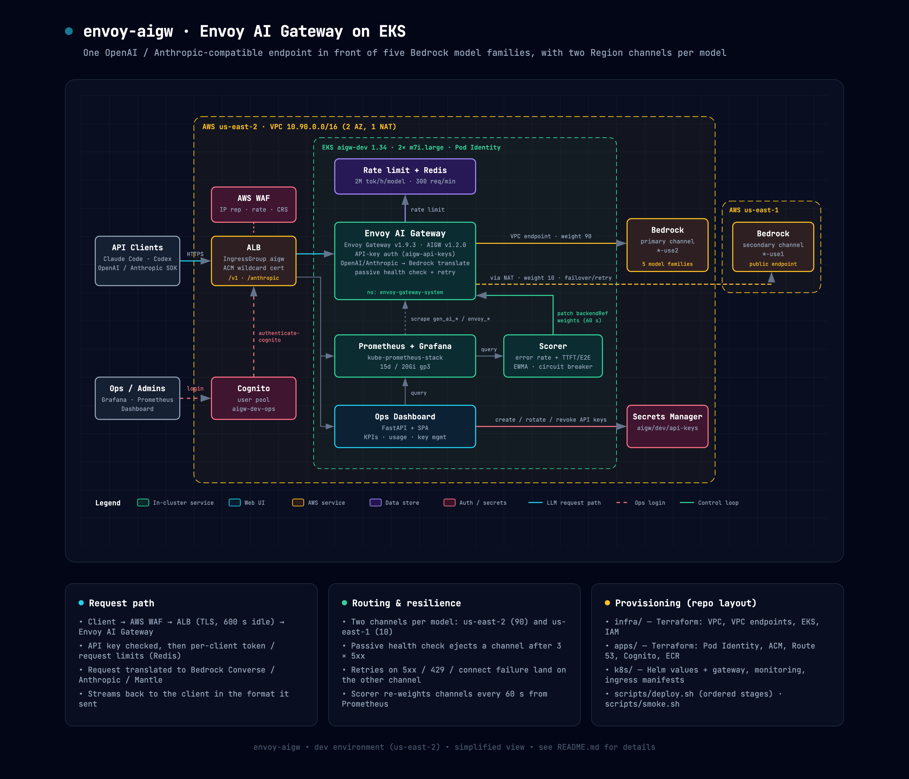

# envoy-aigw — Envoy AI Gateway on EKS (dev, 50 users)

Unified OpenAI / Anthropic-compatible entry point in front of five Bedrock model families
(Claude, GPT via Bedrock Mantle, Kimi, DeepSeek, GLM) in us-east-2.



Interactive version (export PNG/PDF): [`docs/architecture-simplified.html`](docs/architecture-simplified.html).

```
infra/        Terraform state 1: VPC (10.90.0.0/16, 2 AZ, 1 NAT), VPC endpoints (bedrock-runtime, bedrock-mantle, s3),
              EKS 1.34 (2 x m7i.large, Pod Identity, EBS CSI), IAM roles (Bedrock invoke, ALB controller, EBS CSI)
apps/         Terraform state 2: Pod Identity associations; ACM + Route 53 (off until a hosted zone is chosen)
k8s/          Helm values + manifests: Envoy Gateway v1.9.3, Envoy AI Gateway v1.2.0, gateway resources, Redis, ALB Ingress
scripts/      deploy.sh (helm + kubectl, in order), smoke.sh (end-to-end tests through a port-forward)
docs/         architecture-simplified.html (open in a browser; export PNG/PDF from the ⋯ menu)
```

## Deploy order

```bash
cd infra && terraform init && terraform apply                 # ~20 min
aws eks update-kubeconfig --name aigw-dev --region us-east-2
cd ../apps && terraform init && terraform apply               # pod identity associations
cd .. && scripts/deploy.sh platform                           # ALB controller, Envoy Gateway, AI Gateway controller
scripts/deploy.sh gateway                                     # Gateway, backends, routes, API-key secret, Redis
scripts/smoke.sh                                              # all models via port-forward
```

Public ingress (after choosing a Route 53 hosted zone):

```bash
# apps/terraform.tfvars
ingress = { enabled = true, hostname = "llm.example.com", hosted_zone_id = "Z..." }
cd apps && terraform apply            # ACM cert + DNS validation (Route 53 alias is created on the 2nd apply)
cd .. && scripts/deploy.sh ingress    # ALB
cd apps && terraform apply            # Route 53 alias -> ALB
```

## Monitoring

`scripts/deploy.sh monitoring` installs kube-prometheus-stack (Prometheus 15d/20Gi on gp3, Grafana 5Gi, no Alertmanager)
plus `k8s/monitoring/10-monitors.yaml`: a PodMonitor on the Envoy data-plane pods (extproc `:1064/metrics` for
`gen_ai_*`, Envoy `:19001/stats/prometheus` for `envoy_*`, filtered to the families we use) and ServiceMonitors for the
AI Gateway controller, Envoy Gateway and the rate-limit service. Dashboards in `k8s/monitoring/dashboards/*.json`
are provisioned as ConfigMaps (the upstream "Envoy AI Gateway - GenAI Overview" is included).

Public access on the shared ALB (IngressGroup `aigw`, wildcard ACM cert, `k8s/ingress/monitoring-ingress.yaml.tmpl`):

| URL | Auth |
|---|---|
| https://grafana.aigw.example.com | Grafana login, user `admin`; password: `kubectl -n monitoring get secret kube-prometheus-stack-grafana -o jsonpath='{.data.admin-password}' \| base64 -d` |
| https://prometheus.aigw.example.com | ALB Cognito login (user pool `aigw-dev-ops`, `apps/ingress.tf`). First user + temporary password in Secrets Manager `aigw/dev/cognito-ops-admin`; add users with `aws cognito-idp admin-create-user` |

Prometheus itself has no authentication, which is why it sits behind the ALB `authenticate-cognito` action;
never expose its Service directly. Tunnel access still works: `kubectl -n monitoring port-forward svc/kube-prometheus-stack-prometheus 9090:9090`.

Useful queries: `sum by (gen_ai_original_model, gen_ai_token_type) (rate(gen_ai_client_token_usage_sum[5m]))`,
`histogram_quantile(0.95, sum by (le) (rate(gen_ai_server_time_to_first_token_seconds_bucket[5m])))`,
`sum(envoy_http_downstream_rq_active)` (in-flight streams; the KEDA signal for prod).

## AWS WAF

`apps/waf.tf` creates the regional web ACL `aigw-<env>`; `scripts/deploy.sh ingress` renders its ARN into the `aigw`
Ingress as `alb.ingress.kubernetes.io/wafv2-acl-arn`, and the ALB controller attaches it to the shared ALB (API,
Grafana, Prometheus, dashboard). Rules, in order: Amazon IP reputation list, per-IP rate limit (6000 req / 5 min,
answered with 429), Known Bad Inputs, Common Rule Set. Body-inspecting rules (`SizeRestrictions_BODY`,
`CrossSiteScripting_BODY`, `GenericLFI_BODY`, `GenericRFI_BODY`, `EC2MetaDataSSRF_BODY`, `Log4JRCE_BODY`,
`JavaDeserializationRCE_BODY`) are COUNT only: agent prompts are > 8 KB and full of code, so they would block
normal traffic. Logs: CloudWatch `aws-waf-logs-aigw-<env>` (30 days; `authorization`, `x-api-key`, `cookie` redacted).
Knobs in `apps/terraform.tfvars`: `waf = { count_only = true }` (nothing blocks, for tuning),
`rate_limit_per_5min`, `enabled = false` (then `scripts/deploy.sh ingress` sets the annotation to `none` and detaches).

## Scorer (quality-based weights)

`services/scorer` (ported from the TPP scorer, ns `scorer`, single replica, off the request path) reads the trailing
10 min from Prometheus every 60 s, scores each channel of a model on error rate (weight 0.65) and relative
TTFT/E2E p90 over successful requests (0.35), smooths with EWMA, and patches `backendRefs[].weight` in the
AIGatewayRoute: `weight ∝ prior · q²` with the configured 90/10 as prior, 5 % floor, breaker at > 50 % weighted
error rate (channel drops to a 1 % probe share), recovery after 3 clean rounds. Metrics `scorer_*` feed the
dashboard's channel column and two alerts (`AigwScorerStale`, `AigwChannelCircuitOpen`).
Deploy: `scripts/deploy.sh scorer`. Freeze weights: `kubectl -n scorer scale deploy/scorer --replicas=0`.
Details: `services/scorer/README.md`.

## Ops dashboard

`services/dashboard` (FastAPI + static SPA, modelled on the TPP dashboard) at **https://dashboard.aigw.example.com**
behind the same Cognito login as Prometheus. KPIs, gateway health, per-client usage against the rate limits with
**create / rotate / revoke** of client API keys (Secrets Manager is written first, then the `aigw-api-keys` Secret),
per-model tokens / cache hit rate / TTFT-TPOT-E2E percentiles. Deploy: `scripts/deploy.sh dashboard` (builds and
pushes the image to the ECR repo from `apps/dashboard.tf`), then `scripts/deploy.sh ingress`. Details in
`services/dashboard/README.md`.

## Two channels per model, error-based failover

Every public model routes to two channels in one Envoy cluster, named by Region: `*-use2` (us-east-2, primary,
VPC endpoint, weight 90) and `*-use1` (us-east-1, secondary, public endpoint via NAT, weight 10) — e.g.
`bedrock-anthropic-use2` / `bedrock-anthropic-use1`. The `gen_ai_backend` metric label carries the same names. `13-backend-traffic-policy.yaml` adds a passive
health check (3 consecutive 5xx / gateway errors eject a channel for 30 s, doubling) and a retry on
connect failures / 5xx / 429 that lands on the other channel. The weights are the knob for a quality-based scorer
(TPP-style) that reads `gen_ai_*` per `gen_ai_backend` from Prometheus and patches `backendRefs[].weight`.
The IAM policy allows `inference-profile/*` in every region for this. Trade-off: prompt cache is per Region, so
the 10 % on the secondary are cache misses for those turns.

## Model names

| Client model name | Bedrock model | Translator |
|---|---|---|
| `claude-opus-5-5` / `claude-sonnet-5-5` / `claude-haiku-5-5` | `us.anthropic.claude-*-5-5` | AWSAnthropic (native `/anthropic/v1/messages` + `/v1/chat/completions`) |
| `gpt-5.6-terra` | `us.openai.gpt-5.6-terra` | AWSBedrock (Converse) — chat only; Mantle currently rejects gpt-5.6/5.5 on every route (2026-11-03) |
| `gpt-oss-120b` | `openai.gpt-oss-120b` via bedrock-mantle | OpenAI passthrough (`/v1/chat/completions`, `/v1/responses`) |
| `kimi-k3` | `us.moonshotai.kimi-k3` | AWSBedrock (Converse) |
| `deepseek-v3.2` | `deepseek.v3.2` | AWSBedrock (Converse) |
| `glm-5` | `zai.glm-5` (text only) | AWSBedrock (Converse) |
| `glm-5.3` | `us.zai.glm-5.3` (text only) | AWSBedrock (Converse) — throttled until the account gets a GLM 5.3 quota |

## Clients

API keys live in Secrets Manager `aigw/dev/api-keys` (JSON, client id -> key) and are synced into the
`aigw-api-keys` Secret by `scripts/deploy.sh gateway`. Add a client: edit the Secrets Manager JSON, re-run that step.

- Claude Code: `ANTHROPIC_BASE_URL=https://<host>/anthropic`, `ANTHROPIC_API_KEY=<key>`, model `claude-sonnet-5-5`
- Codex: provider base URL `https://<host>/v1`, `wire_api = "responses"`, model `gpt-5.6-terra`
- OpenAI SDK: `base_url=https://<host>/v1`, `api_key=<key>`

## Tuned for agent traffic (see design doc §6)

ALB idle 600 s / deregistration 300 s · Envoy drain 300 s · request timeout 900 s · circuit breakers 8192 ·
client buffer 50 MiB · per-client limits: 2M tokens/hour/model, 300 req/min.
